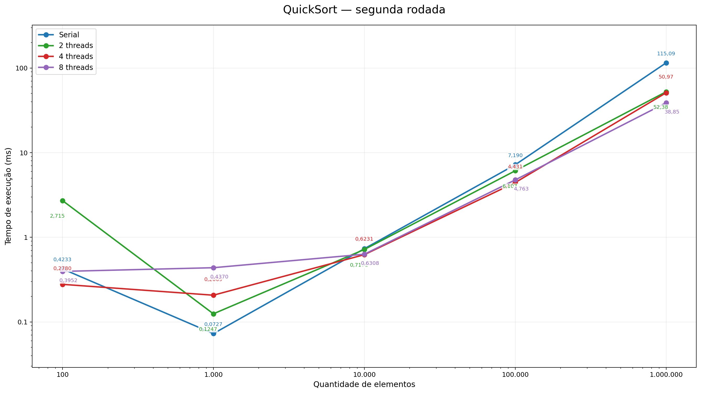
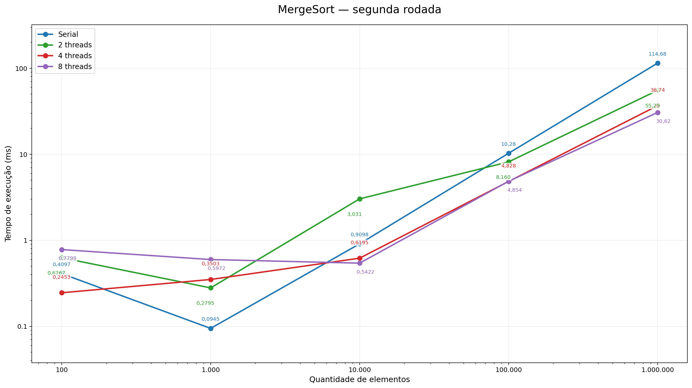
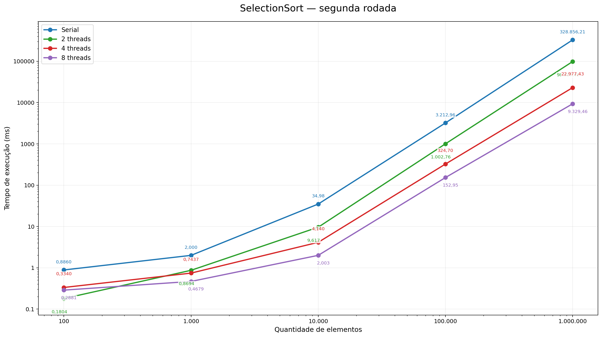
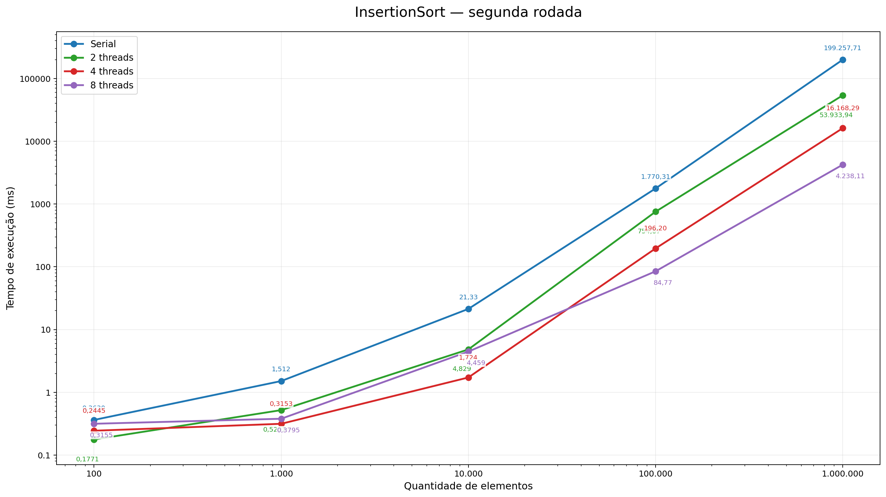
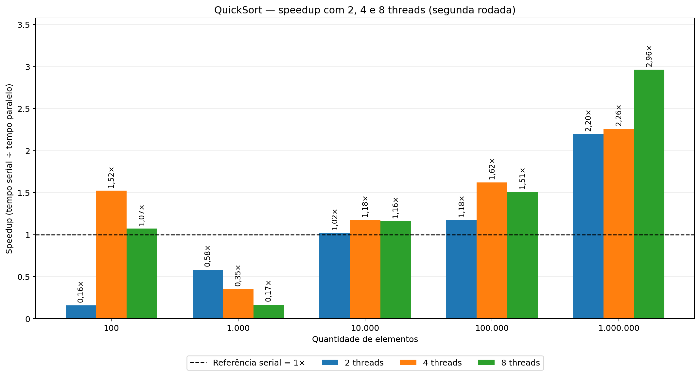
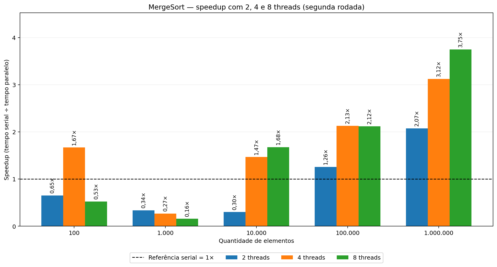
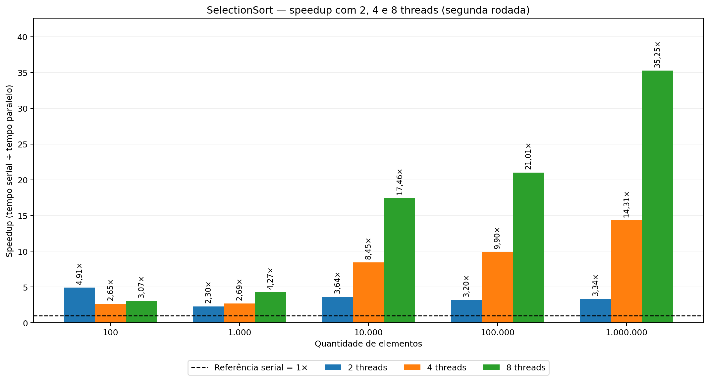
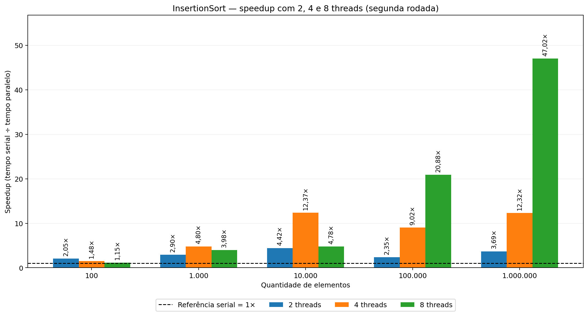

# Análise de desempenho de algoritmos de ordenação em ambientes seriais e paralelos
Alunos: Anselmo Teixeira Ferrer Neto - 2410414 e Ana Beatriz Silveira Mendes - 2410411 
## Resumo

Este trabalho tem como objetivo analisar o desempenho de quatro algoritmos de ordenação implementados em Java, comparando suas versões seriais e paralelas. Foram utilizados QuickSort, MergeSort, SelectionSort e InsertionSort, com conjuntos de 100, 1.000, 10.000, 100.000 e 1.000.000 de elementos. Os testes foram realizados em duas rodadas: a primeira com até 4 threads e a segunda com até 8 threads. Os tempos foram registrados em arquivos CSV e comparados para identificar diferenças entre os algoritmos, o efeito do tamanho das entradas e as vantagens e limitações do paralelismo. Os resultados mostram que o uso de mais threads pode reduzir o tempo de execução, principalmente com entradas maiores, mas também que o ganho depende do algoritmo e das condições do teste.

**Palavras-chave:** Java; algoritmos de ordenação; computação paralela; threads; análise de desempenho.

## Introdução

A necessidade de processar uma quantidade cada vez maior de informações tornou importante buscar maneiras de melhorar o desempenho dos programas. Uma possibilidade é utilizar vários núcleos do processador para executar partes de uma tarefa ao mesmo tempo. Entretanto, dividir um trabalho entre várias threads nem sempre significa que ele será concluído mais rapidamente.

Neste projeto foram implementadas versões seriais e paralelas de quatro algoritmos de ordenação: QuickSort, MergeSort, SelectionSort e InsertionSort. O QuickSort divide os dados em partes a partir de um pivô. O MergeSort divide o conjunto e depois reúne as partes ordenadas. Já o SelectionSort seleciona sucessivamente os menores elementos, enquanto o InsertionSort insere cada elemento em sua posição adequada dentro da parte já ordenada.

O objetivo foi comparar o comportamento desses métodos com diferentes quantidades de dados e threads. Mais do que identificar qual execução foi mais rápida, a intenção foi entender em quais situações o paralelismo trouxe vantagens e por que aumentar o número de threads não garante sempre um resultado melhor.

## Metodologia

Para avaliar o desempenho dos algoritmos, foram realizados testes com conjuntos de dados de 100, 1.000, 10.000, 100.000 e 1.000.000 de elementos, utilizando execuções seriais e paralelas. Os testes foram divididos em duas rodadas: a primeira com 2 e 4 threads e a segunda incluindo também 8 threads.

Os dados de entrada foram gerados aleatoriamente em cada tamanho e copiados antes de cada execução, garantindo que as versões de um mesmo teste recebessem os mesmos elementos. O programa também conferiu os resultados da ordenação. Os tempos foram medidos em milissegundos e registrados em arquivos CSV para comparar o comportamento dos algoritmos conforme o aumento da quantidade de elementos e de threads. Também foram comparados os resultados das duas rodadas para observar possíveis variações de desempenho entre execuções com as mesmas configurações.

A análise foi realizada a partir da comparação dos tempos de execução e do cálculo do *speedup*, que representa a relação entre o tempo serial e o paralelo. Esse cálculo permite verificar quantas vezes uma execução paralela foi mais rápida ou mais lenta que a serial. Também foram utilizados gráficos comparativos para facilitar a visualização das diferenças e identificar em quais situações o paralelismo apresentou vantagens.

Por fim, os resultados foram analisados considerando tanto o ganho de desempenho com o uso de múltiplas threads quanto o tempo total de execução de cada algoritmo. Dessa forma, foi possível avaliar se o aumento do número de threads realmente contribuiu para melhorar o desempenho e compreender as diferenças observadas entre os algoritmos.

## Resultados e Discussão

### Comparação entre as duas rodadas

Considerando apenas as configurações serial, 2 e 4 threads, os dois arquivos apresentam as mesmas 60 configurações em comum, sem registros duplicados nessas combinações. Apesar disso, seus tempos não são iguais. Apenas 23 das 60 medições equivalentes apresentaram diferença de até 10%, e a diferença percentual absoluta mediana foi de aproximadamente 15,7%. Isso mostra que não seria correto considerar as rodadas como resultados idênticos.

Também foi possível perceber que, em geral, as entradas maiores produziram tempos proporcionalmente mais próximos nas duas rodadas. Para 1.000.000 de elementos, a diferença percentual absoluta mediana ficou em aproximadamente 8,8%, enquanto para 1.000 elementos foi de aproximadamente 26,8%. Tempos muito pequenos ficam mais sujeitos a variações proporcionais: uma alteração de poucos décimos de milissegundo pode representar uma diferença percentual elevada.

Alguns casos se destacaram. No MergeSort com 10.000 elementos e 2 threads, o tempo passou de 0,652 ms na primeira rodada para 3,031 ms na segunda. No InsertionSort com 100.000 elementos e 2 threads, passou de 465,689 ms para 754,867 ms. Portanto, esses casos não devem ser utilizados isoladamente para afirmar que uma configuração é superior. Para os gráficos e os números a seguir, foi utilizada a segunda rodada, por incluir também 8 threads; a primeira foi mantida como referência de comparação.

### Comparação dos tempos com 1.000.000 de elementos

A tabela apresenta os tempos da segunda rodada, em milissegundos, comparando a execução serial com 2, 4 e 8 threads.

| Algoritmo | Serial | 2 threads | 4 threads | 8 threads |
|---|---:|---:|---:|---:|
| QuickSort | 115,090 | 52,383 | 50,972 | 38,847 |
| MergeSort | 114,685 | 55,287 | 36,744 | 30,615 |
| SelectionSort | 328.856,211 | 98.327,490 | 22.977,430 | 9.329,464 |
| InsertionSort | 199.257,707 | 53.933,942 | 16.168,289 | 4.238,114 |

Para esse tamanho, todos os algoritmos apresentaram redução de tempo ao utilizar 8 threads em relação à versão serial. Entretanto, a diferença absoluta entre eles continuou muito grande. O MergeSort com 8 threads executou em 30,615 ms, seguido do QuickSort com 38,847 ms. O InsertionSort levou 4.238,114 ms e o SelectionSort, 9.329,464 ms. Isso mostra que acelerar um algoritmo não significa necessariamente torná-lo mais rápido do que outro que já possui um funcionamento mais adequado para grandes entradas.

### QuickSort

O QuickSort apresentou tempos baixos quando comparado ao SelectionSort e ao InsertionSort, principalmente nos conjuntos maiores. Com 100.000 elementos, a versão serial levou 7,190 ms, enquanto a paralela com 4 threads levou 4,431 ms. Com 1.000.000 de elementos, o tempo caiu de 115,090 ms na versão serial para 38,847 ms com 8 threads, uma execução aproximadamente 2,96 vezes mais rápida.

Entretanto, o resultado não melhorou sempre que o número de threads aumentou. Com 100.000 elementos, 4 threads foram mais rápidas que 8, que registraram 4,763 ms. Já com 1.000 elementos, a versão serial levou 0,073 ms, enquanto a paralela com 8 threads levou 0,437 ms. Nesse último caso, o custo adicional de trabalhar com várias threads foi maior que o benefício observado. Dessa forma, os testes indicam que o paralelismo se torna mais vantajoso para o QuickSort quando existe uma quantidade maior de dados para processar.

### MergeSort

O MergeSort também apresentou bons resultados nas entradas maiores. Com 1.000.000 de elementos, a execução serial levou 114,685 ms, enquanto a paralela com 8 threads levou 30,615 ms, sendo aproximadamente 3,75 vezes mais rápida. Nesse cenário, foi o menor tempo registrado entre os quatro algoritmos testados.

Com 100.000 elementos, o tempo caiu de 10,276 ms na execução serial para 4,828 ms com 4 threads. O uso de 8 threads praticamente não trouxe ganho adicional, registrando 4,854 ms. Nos conjuntos pequenos, porém, os tempos paralelos foram frequentemente maiores. Com 1.000 elementos, por exemplo, o serial levou 0,095 ms e a execução com 8 threads levou 0,597 ms. O MergeSort mostra, portanto, que a divisão do trabalho pode ser eficiente em entradas grandes, mas que existe um custo para organizar e reunir as tarefas paralelas.

No conjunto de 10.000 elementos, a diferença expressiva entre as duas rodadas para 2 threads exige cuidado. Esse resultado isolado não permite concluir que 2 threads sejam sempre uma configuração ruim ou boa.

### SelectionSort

O SelectionSort apresentou os maiores tempos de execução nas entradas grandes, principalmente na versão serial. Com 1.000.000 de elementos, o tempo serial foi de 328.856,211 ms, aproximadamente 5 minutos e 29 segundos. Com 8 threads, caiu para 9.329,464 ms, aproximadamente 9,33 segundos. A execução paralela foi cerca de 35,25 vezes mais rápida nesse teste.

Essa foi uma melhoria proporcional muito expressiva, mas o SelectionSort ainda ficou bastante atrás do QuickSort e do MergeSort. Mesmo utilizando 8 threads, seu tempo com 1.000.000 de elementos foi mais de 300 vezes o tempo do MergeSort com 8 threads. Esse resultado é importante porque permite separar dois conceitos: o ganho obtido ao paralelizar um método e o desempenho final desse método em relação aos demais. Um algoritmo pode melhorar muito em relação à sua própria versão serial e continuar sendo uma escolha lenta para grandes volumes de dados.

Nos testes com 10.000, 100.000 e 1.000.000 de elementos, aumentar as threads reduziu progressivamente os tempos registrados na segunda rodada. Na implementação paralela, o vetor é dividido em trechos, cada thread executa o SelectionSort em sua parte e, ao final, os trechos são reunidos por meio da intercalação do MergeSort. Por isso, o ganho superior à quantidade de threads não ocorre apenas pela execução simultânea: a forma de organizar a ordenação também mudou em relação à versão serial.

### InsertionSort

O InsertionSort também apresentou grande crescimento do tempo com o aumento da quantidade de elementos. Para 1.000.000 de elementos, o tempo serial foi de 199.257,707 ms, aproximadamente 3 minutos e 19 segundos. Com 8 threads, o tempo caiu para 4.238,114 ms, ou cerca de 4,24 segundos. A razão entre os tempos foi de aproximadamente 47,02 vezes, o maior ganho proporcional da segunda rodada nesse tamanho de entrada.

Apesar dessa melhora, o InsertionSort com 8 threads ainda foi muito mais lento do que o QuickSort e o MergeSort na mesma configuração. Também foi possível perceber que mais threads nem sempre significaram melhor desempenho. Com 10.000 elementos, a execução com 4 threads levou 1,724 ms, enquanto a de 8 threads levou 4,459 ms. Nesse caso, aumentar a quantidade de threads piorou o resultado.

Assim como no SelectionSort, a versão paralela do InsertionSort divide o vetor em trechos, ordena cada parte em threads separadas e depois utiliza a intercalação do MergeSort para formar o resultado final. Essa mudança também ajuda a explicar o speedup superior a 8: a versão paralela combina o trabalho simultâneo com uma estratégia diferente da ordenação serial completa.

### Comparação do ganho de desempenho (speedup)

Além dos tempos de execução, os gráficos a seguir apresentam o *speedup* das versões com 2, 4 e 8 threads em relação à versão serial. O cálculo foi feito dividindo o tempo serial pelo tempo paralelo. Um resultado maior que 1 indica ganho de desempenho; menor que 1 indica que a execução paralela demorou mais.

**QuickSort:** com 1.000.000 de elementos, o speedup chegou a aproximadamente 2,96 com 8 threads. Em entradas pequenas, o paralelismo nem sempre compensou.

**MergeSort:** o maior ganho com 1.000.000 de elementos foi de aproximadamente 3,75 com 8 threads. Nos conjuntos menores, o comportamento foi menos favorável.

**SelectionSort:** apresentou speedup de aproximadamente 35,25 com 8 threads e 1.000.000 de elementos, mas continuou mais lento em tempo absoluto que QuickSort e MergeSort.

**InsertionSort:** registrou o maior ganho proporcional nesse tamanho, aproximadamente 47,02 com 8 threads, embora seu tempo final ainda tenha sido maior que o dos dois algoritmos mais rápidos.

Nos casos de SelectionSort e InsertionSort, os ganhos mais elevados refletem tanto a divisão da ordenação entre as threads quanto o uso da intercalação do MergeSort para reunir os trechos ordenados.

### O que os resultados mostram sobre o paralelismo

Ao analisar os quatro algoritmos, foi possível perceber que o tamanho da entrada influencia bastante a utilidade do paralelismo. Nos testes pequenos, os tempos foram baixos e o uso de várias threads frequentemente não compensou. Isso pode acontecer porque criar, organizar e sincronizar tarefas também exige processamento. Já nos conjuntos maiores, o trabalho disponível foi suficiente para que diferentes execuções paralelas apresentassem ganhos mais claros.

Outro ponto importante é que o desempenho não cresce obrigatoriamente na mesma proporção que o número de threads. Dobrar a quantidade de threads não significa reduzir o tempo pela metade. Nem todas as etapas podem ser paralelizadas: no QuickSort, a divisão do vetor ocorre antes do processamento das partes; no MergeSort, a intercalação final acontece depois que os dois lados terminam. No SelectionSort e no InsertionSort paralelos, a reunião dos trechos ordenados também é feita em sequência. Essas partes seriais limitam o ganho que pode ser obtido com mais threads, pois apenas a parcela paralelizável pode aproveitar diretamente a execução simultânea. Além disso, criar e coordenar threads também possui um custo.

Também foi possível entender a diferença entre comparar versões de um mesmo algoritmo e comparar algoritmos distintos. SelectionSort e InsertionSort apresentaram melhorias proporcionais superiores às de QuickSort e MergeSort nos testes de 1.000.000 de elementos. Mesmo assim, estes dois últimos continuaram muito mais rápidos em termos absolutos. Portanto, a escolha de um algoritmo deve considerar tanto sua forma de resolver o problema quanto a maneira como o trabalho pode ser dividido.

Por fim, os resultados reforçam a importância de repetir os testes. As duas rodadas apresentaram a mesma tendência geral, mas também tiveram diferenças significativas em configurações específicas. Comparar essas variações ajudou a entender por que uma única medição não deve ser usada isoladamente para avaliar o desempenho de uma configuração.

## Conclusão

Com este trabalho, foi possível compreender melhor como a execução serial e a paralela podem apresentar comportamentos diferentes de acordo com o algoritmo e a quantidade de dados. Os testes mostraram que utilizar várias threads pode reduzir bastante o tempo de processamento em entradas grandes, mas também que nem sempre vale a pena dividir tarefas pequenas.

Também foi possível perceber que um ganho elevado em relação à versão serial não significa que um algoritmo seja o mais rápido. Apesar das grandes reduções de tempo observadas no SelectionSort e no InsertionSort, o QuickSort e o MergeSort apresentaram os melhores tempos absolutos com 1.000.000 de elementos. Isso ajudou a compreender que o desempenho depende não apenas da quantidade de threads, mas também do próprio funcionamento do algoritmo.

Além disso, a comparação entre as duas rodadas mostrou que medições de tempo podem variar, sendo necessário considerar várias execuções antes de tirar conclusões definitivas. Dessa forma, o principal aprendizado foi entender que o paralelismo é uma ferramenta para melhorar o desempenho em determinadas condições, e não uma garantia de que qualquer programa ficará mais rápido apenas por utilizar mais threads.

## Códigos das implementações

Os códigos Java utilizados nos testes estão disponíveis no repositório do projeto: [computacao-paralela-av2](https://github.com/abeatrizsm/computacao-paralela-av2).
